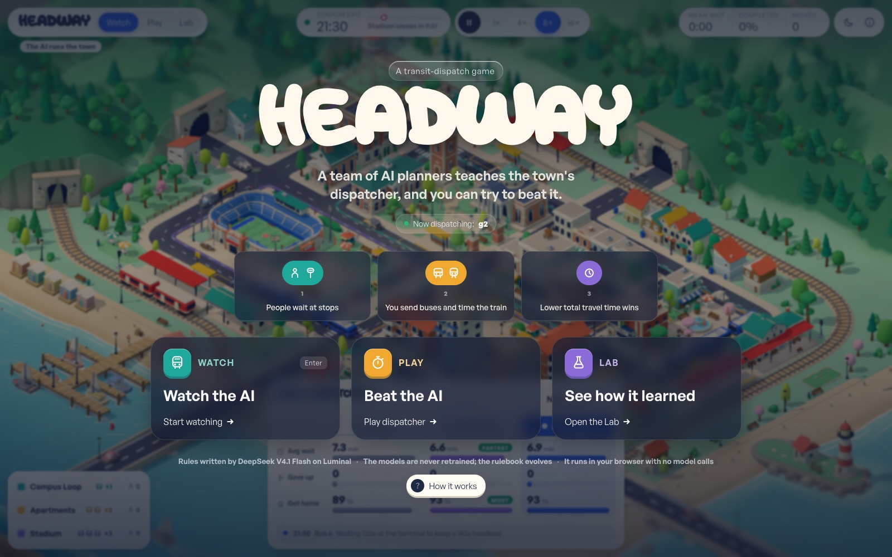
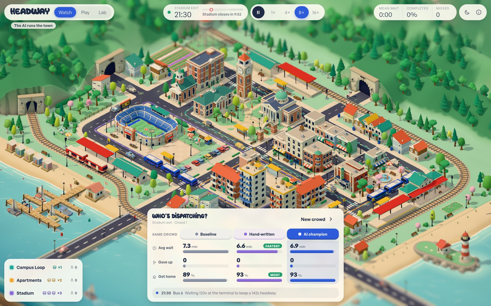
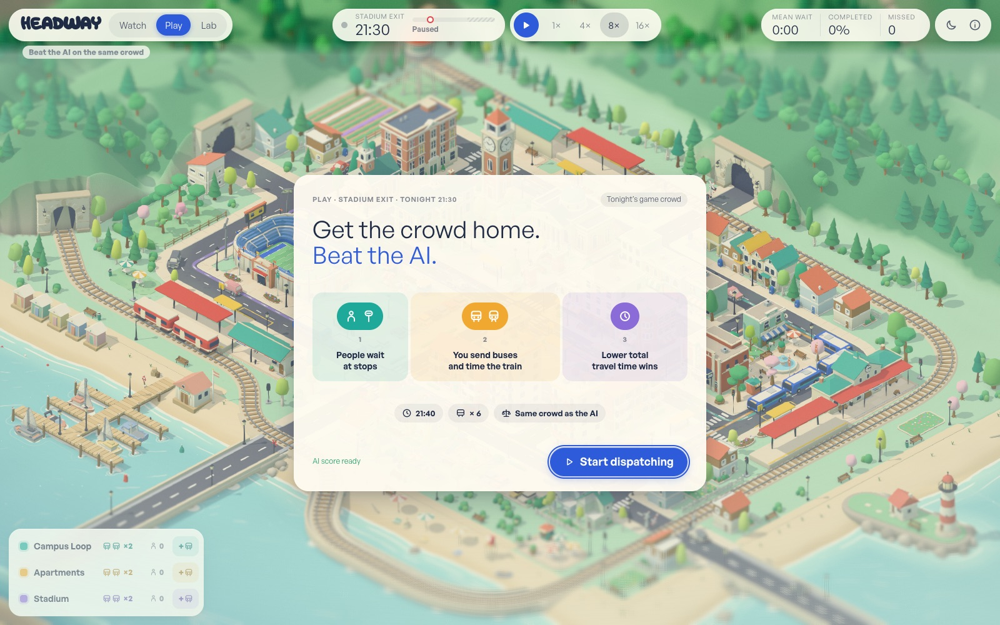
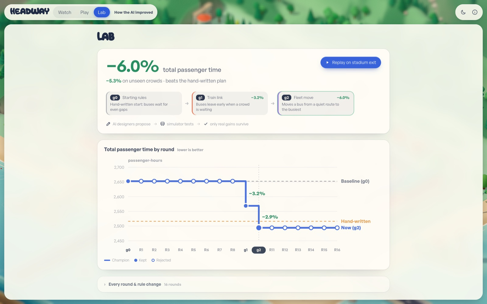
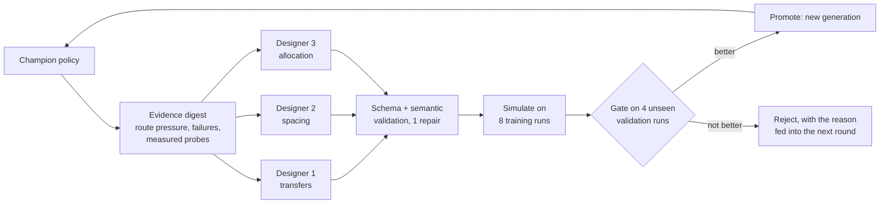
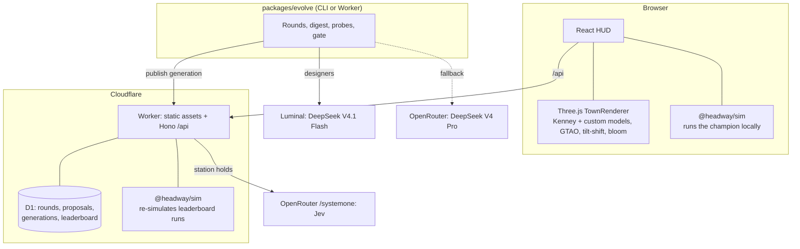

<p align="center">
  
</p>

<h1 align="center">Headway</h1>

<p align="center">
  <b>A toy-diorama transit game whose bus dispatcher is designed by AI, and you can try to beat it.</b><br>
  <a href="https://headway.pranavkarra.me"><b>Play it live → headway.pranavkarra.me</b></a>
</p>

<p align="center">
  Three.js · React · TypeScript · Cloudflare Workers + D1 · DeepSeek V4.1 Flash on Luminal · TypeSafe Jev
</p>

---

Headway is a small isometric college town (inspired by State College, PA) with three bus routes, a regional train
that runs through a ridge tunnel and across a bay bridge, and a stadium that is about to empty. Every passenger has
a real trip. Your job, and the AI's job, is the same: **get everyone home with the least total travel time.**

The twist is how the AI dispatcher gets better. The language models are **never retrained**. Between games, AI
*designers* propose edits to a small, readable **rulebook**; a deterministic simulator tests every edit, and only the
ones that measurably help on crowds the designers have never seen survive. The rulebook then runs in your browser
with no model calls at all.

## Three modes

| **Watch** — the AI runs the town | **Play** — beat the AI on the same crowd |
|---|---|
|  |  |
| Click any bus to see the exact rule it just followed. Switch *Who's dispatching?* between the baseline, the hand-written plan and the AI champion, and compare them on the identical crowd. | Same crowd, same fleet, same information as the AI. Move buses between routes, hold buses for transfers, time the train, then see your score against the AI and the baseline. |

| **Lab** — see how the AI learned |
|---|
|  |
| Every round of evolution: which designer proposed what, what the simulator measured, and why each change was kept or rejected. |

## Results

Total passenger time **J** (walk + wait + ride, plus a penalty for anyone not home by the end). Lower is better.

| Dispatcher | Training crowds | Unseen validation crowds |
|---|---:|---:|
| `g0` baseline: 2 buses per route, wait at the terminal for even gaps | 0 % | 0 % |
| Hand-written reference plan | −5.1 % | −4.6 % |
| **`g2` AI champion** (evolved) | **−6.0 %** | **−5.3 %** |

16 evolution rounds · 48 designer proposals · **2 promoted**. The loop rejects anything that does not measurably help.

## How the DeepSeek designers create strategies

The strategy is a **policy**: a versioned JSON rulebook of at most 24 rules of the form *"on this decision, when these
features hold, do this action"*. Rules can only read whitelisted features (queue lengths, headway ratios, train ETA, …)
and choose from four actions: **hold**, **dispatch**, **reassign** a bus to another route, or set the **train's
departure**. Each rule carries a `say` template, so the explanation you see when you click a bus is the rule itself,
filled in with the real numbers, never a story written afterwards.



1. **Evidence.** Each round starts from the champion and a compact digest (≤ 6,000 characters) of what went wrong
   on the training crowds: which routes are under pressure, where people waited longest, missed connections, and
   **probes**: dozens of one-step variants of the champion (drop a rule, move a bus, tighten a threshold, add a
   queue guard) that the simulator has already scored. Designers therefore propose changes backed by measurements,
   not guesses.
2. **Three designers.** Three calls to **DeepSeek V4.1 Flash on [Luminal](https://luminal.com)**, each with a
   different emphasis (transfers, spacing, allocation) that rotates between rounds. A novelty rule forbids
   resubmitting ideas that already failed. If Luminal times out or errors, the call falls back once to
   `deepseek/deepseek-v4-pro` on OpenRouter, and the proposal records which model answered.
3. **Validation.** Every proposal is checked with zod plus semantic checks (known features, legal actions, sane
   thresholds). A malformed proposal gets one repair attempt with the exact errors.
4. **Simulation.** Valid proposals run on 8 training runs (`stadium_exit` and `class_change` × 4 seeds). The sim is
   deterministic, so every candidate faces the identical crowds.
5. **Promotion gate.** The best candidate is promoted only if J improves by at least 1 % on training **and** it is no
   worse on 4 validation runs the designers never see, completion drops by at most 1 point, and the worst service
   gap at any stop stays within max(the champion's, 15 min). If it fails, the runner-up gets one try. Three more **sealed test** seeds are kept out of the
   repo and out of every prompt.

What survived (`g0 → g1 → g2`):

```jsonc
// g1: "Buses leave early when a crowd is waiting" (−3.2 %)
{ "on": "bus_at_terminal", "when": [{ "f": "route_queue", "op": ">=", "v": 3 }], "do": { "type": "dispatch" },
  "say": "Queue relief: {route_queue} waiting, dispatching now" }

// g2: "Move a bus from a quiet route to the busiest" (−6.0 %)
"allocation": { "r1": 1, "r2": 2, "r3": 3 },
{ "on": "bus_at_terminal", "when": [{ "f": "queue_ratio_other", "op": ">=", "v": 6.67 }],
  "do": { "type": "reassign", "to": "busiest" }, "say": "Reassigning to busiest route: queue_ratio_other is {queue_ratio_other}" }
```

### Bring your own model: local, Ollama or any provider

DeepSeek on Luminal is only the default. The designers talk to any **OpenAI-compatible `/chat/completions`
endpoint**, so you can swap in a local model with no code changes. For example, with [Ollama](https://ollama.com):

```bash
ollama pull qwen3:14b                      # or any model that can answer in JSON
```

```bash
# .env (repo root)
LUMINAL_BASE_URL=http://localhost:11434/v1   # Ollama's OpenAI-compatible endpoint
LUMINAL_API_KEY=ollama                       # any non-empty value; local servers ignore it
# leave OPENROUTER_API_KEY unset to stay fully offline (no cloud fallback)
```

```bash
pnpm evolve --smoke --model qwen3:14b        # one designer call, nothing saved
pnpm evolve --rounds 3 --model qwen3:14b     # real rounds with your local designers
```

- The same works for **LM Studio** (`http://localhost:1234/v1`), **llama.cpp server**, **vLLM** or any hosted
  OpenAI-compatible provider: set the base URL and pass `--model`.
- With only `OPENROUTER_API_KEY` set, every designer call goes to OpenRouter instead. Choose the model with
  `--fallback-model` (for example `--fallback-model qwen/qwen3-235b-a22b`).
- The model must return a JSON object (JSON mode) within the 90 s designer timeout. Smaller models lean on the
  repair attempt more often, but the promotion gate is the same for everyone, so a weaker model only means fewer
  promotions: it can never make the champion worse.
- A local server is reachable from the CLI only. The deployed Worker's `/api/evolve` needs a public URL.

## How Jev is used

**Jev** (TypeSafe `typesafe/jev-1.13`, via OpenRouter's `/systemone` endpoint) is a fast
decision model that picks one option from a list and returns a probability for each. Headway uses it for exactly one
kind of decision, a **station hold**:

> A bus is at a train-station stop and a train is due. Should it **depart now**, or **hold 20, 40 or 60 s** so
> transferring passengers can make it?

- **Code generates the legal options**, and Jev only chooses among them, so it can never produce an invalid action.
  The policy decides *when* Jev is asked (by default when `train_eta_s ≤ 120`) and the hold options to offer. Those
  fields, plus Jev's operating instructions, are part of the policy, so the designers can evolve them too.
- **Rules are the safety net.** On a timeout (800 ms) or an error, the rulebook decides as usual.
- **Replays stay deterministic.** Every Jev answer is logged into the replay, so re-simulating a run (for the
  leaderboard or the Lab) never calls Jev again.
- In the browser, Jev is reached through the Worker's rate-limited, cached proxy `POST /api/jev/decide`. The CLI uses
  the same request body, so browser and CLI decisions match.

Honest result so far: in the recorded comparison ([`data/jev-compare.json`](data/jev-compare.json)) Jev was asked 20
times and chose *depart now* every time, which is exactly what the rules do, so the shipped champion `g2` is
rules-only. The Jev track is fully wired and ready for designers to evolve its instructions.

## The simulator

- **Deterministic.** 1-second ticks; every random draw (crowd, rider behaviour, train delays) comes from named
  seeded streams before the run starts. A full scenario runs in about 10 ms, with identical hashes in the browser,
  in Node and in the Worker. That makes comparisons fair (everyone faces the same crowd) and lets the server
  **re-simulate** submitted leaderboard runs instead of trusting the client.
- **Fair Play mode.** You control the baseline `g0` plus your own interventions, on the same seed the AI and baseline
  are scored on. Doing nothing scores exactly the baseline.
- **Render-only extras.** Ambient car traffic, bus queuing on screen and the day/night cycle are visual only. They
  never touch the score.

## Architecture



| Package | What it is |
|---|---|
| `packages/sim` | Deterministic sim: town map, scenarios, engine, policy DSL and interpreter, metrics, Jev advisor controller. Depends only on `zod`. |
| `packages/evolve` | LLM client (Luminal + OpenRouter fallback), prompts, digest, probes, rounds, Jev provider, CLIs. |
| `apps/web` | Vite + React HUD, Three.js renderer, sim runner and Web Worker for headless comparisons. |
| `apps/worker` | Cloudflare Worker: static assets, Hono `/api/*`, D1 migrations, Jev proxy, leaderboard verification. |
| `data/` | Evolution output: generations, rounds, events, Jev comparison. |
| `docs/` | Design spec, build plan, art direction, demo scripts. |

## Run it

Requires Node ≥ 22 and pnpm 11 (`corepack enable`).

```bash
pnpm install
pnpm dev                 # http://localhost:5173 — reads the published champion from apps/web/public/data
pnpm test                # vitest across all packages
pnpm typecheck
```

Evolve your own generations (needs `LUMINAL_API_KEY` and `OPENROUTER_API_KEY` in a gitignored `.env`):

```bash
pnpm sim:run --policy g0 --scenario stadium_exit --seed 1001   # one run, prints metrics
pnpm evolve --rounds 3                                         # 3 rounds → data/generations, data/rounds
pnpm evolve --rounds 3 --publish https://headway.pranavkarra.me   # also publishes to D1 (needs ADMIN_TOKEN)
```

Deploy (one Worker serving the app and the API):

```bash
cd apps/worker && pnpm exec wrangler d1 migrations apply headway --remote
pnpm exec wrangler secret put LUMINAL_API_KEY      # also OPENROUTER_API_KEY, ADMIN_TOKEN
cd ../.. && pnpm run deploy
```

<details>
<summary><b>API</b></summary>

| Endpoint | Behaviour |
|---|---|
| `GET /api/health` | `{ ok, simVersion, time }` |
| `GET /api/champion` | `{ policy, generation, train, val }` (falls back to `g0`) |
| `GET /api/generations`, `GET /api/generations/:id` | generation summaries with baseline and reference scores |
| `POST /api/evolve` (Bearer `ADMIN_TOKEN`) | runs one round, streaming events as NDJSON |
| `GET /api/leaderboard?seed=`, `POST /api/leaderboard` | top 20 for a play seed; submissions are re-simulated on the server |
| `POST /api/jev/decide` | rate-limited, cached proxy to Jev |
| `POST /api/admin/publish`, `POST /api/admin/sealed-eval`, `GET /api/sealed` | CLI publish and sealed-test results |

</details>

<details>
<summary><b>Play controls</b></summary>

Click-first: click a bus, a stop or the train and use the buttons on the card. Keyboard: `D` dispatch, `H` hold 30 s
(`Shift+H` 60 s), `R` then `1`/`2`/`3` to reassign, `T` hold the train, `Space` pause, `1`–`4` for 1×/4×/8×/16×,
`?` for *How Headway works*. `/?intro` replays the title card.

</details>

## Credits

- 3D models: [Kenney](https://kenney.nl) asset kits (CC0), plus custom low-poly models for the buses, train,
  stations, campus and stadium.
- Fonts: [General Sans](https://www.fontshare.com/fonts/general-sans) (Indian Type Foundry) and Gumball Rounded
  for titles. Font files are **not** included in this repo. Add them to `apps/web/public/fonts/` to match the live
  site; otherwise the app falls back to system fonts.
- Models: DeepSeek V4.1 Flash on Luminal (policy designers), DeepSeek V4 Pro on OpenRouter (fallback), TypeSafe Jev
  (station holds).

Built in one day for a hackathon, 11 October 2026.
